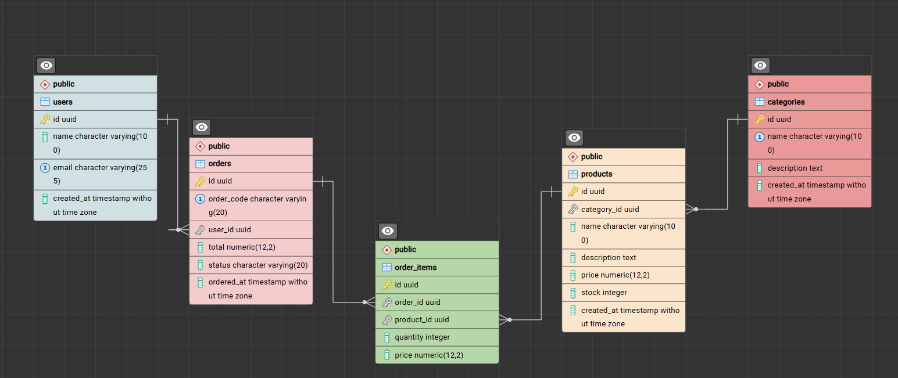
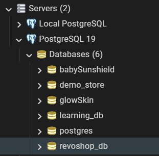

# RevoShop Database

RevoShop is a one-stop-shopping online store that has a wide-range of categories to provide the bare necessities of the customers, from food and beverages to personal care. No more confusion in shopping groceries or other things, for RevoShop online store is only one-click away. This repository contains the PostgreSQL database design for RevoShop.

## Schema Diagram

## Tables
- **users** - customer accounts
- **categories** - product category
- **orders** - the order list
- **products** - the item list
- **order_items** - the products in each order, with quantity and price at purchase

## Prerequisites
- PostgreSQL ver.19
- pgAdmin ver.4

## Setup
1. Clone this repository
2. Create a database named `revoshop_db` through pgAdmin

   

3. Open the Query Tool on `revoshop_db`
4. Run `schema.sql` to create all tables
5. Run `seed.sql` to insert sample data
6. Run `queries.sql` to try the sample queries

## Design Decision
- This repository uses UUID as the id for all tables (users, categories, orders, products, order_items) to keep it hard to guess.
- Stock defaults to 0, so a product added without stock is treated as out of stock instead of falsely available.
- Status defaults to 'pending', so every new order starts as unpaid until payment is confirmed.